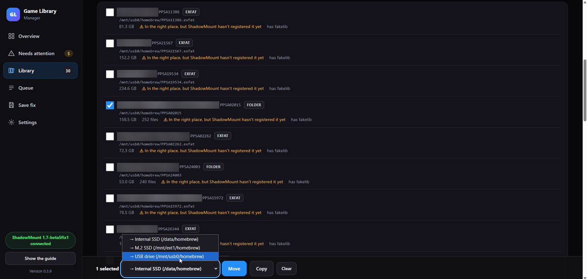

# Game Library Manager (PS5) v0.4.0

By [leedsy90](https://github.com/leedsy90)

A PS5 homebrew payload that keeps your game library tidy for **ShadowMount Plus (SMP)**. It scans every drive for games, tells you which ones SMP can't see and why, and moves, extracts or fixes them, all from a web page on your phone or the PS5 browser.

> Requires a jailbroken PS5 with an ELF loader (for example etaHEN). It does not run on a PC or on a console without a jailbreak.

| | |
|---|---|
| Download | [`glm-0.4.0.elf`](https://github.com/leedsy90/game-library-manager-ps5/releases/latest) (Releases) |
| SHA-256 | `cd70ac6a8f84799625d3d93666ff2675ce24ff3196bdf1ff1b4782f82da7c9b5` |
| Format | ELF64 x86-64 PIE, built with clang 18 and [ps5-payload-sdk](https://github.com/ps5-payload-dev/sdk) v0.43 |
| Source | [`source/`](source/), with a [reproducible build](#source-and-verified-build) |
| Licence | GPL-3.0-or-later ([LICENSE](LICENSE)) |
| Recommended | ShadowMount Plus 1.7 or newer (needed for the "does SMP see it?" checks) |

## Demo

[](media/glm-demo.mp4)

A 90-second walkthrough of the web page: Overview, Needs attention, Library, Queue and Save fix. Click the image to watch the video ([`media/glm-demo.mp4`](media/glm-demo.mp4)). Recorded on v0.3.9, with game names blurred.

## Source and verified build

The full source is in [`source/`](source/): GLM's own C code in `src/`, the web page in `web/index.html`, the home-tile files in `tile/`, and the build tools in `tools/`. Third-party code is in `third_party/`: Igor Pavlov's public-domain LZMA SDK (`.7z` support), zlib 1.3.2 and the compressor from libdeflate 1.26 (reading and rewriting `.ffpfsc` blocks). Each folder has its own licence file.

**The published `glm-0.4.0.elf` is a byte-for-byte reproducible build of this source.** You don't have to trust the binary. Rebuild it yourself and compare:

```sh
git clone https://github.com/leedsy90/game-library-manager-ps5
cd game-library-manager-ps5
sh reproduce-build.sh
```

[`reproduce-build.sh`](reproduce-build.sh) needs Docker. It uses a clean Ubuntu 24.04 container (clang 18.1.3) and ps5-payload-sdk v0.43, builds `source/`, and checks the result against `glm-0.4.0.elf`. It prints `MATCH` when the two are identical. The expected SHA-256 is:

```
cd70ac6a8f84799625d3d93666ff2675ce24ff3196bdf1ff1b4782f82da7c9b5
```

To build it yourself without Docker:

```sh
export PS5_PAYLOAD_SDK=/opt/ps5-payload-sdk
cd source && make
```

## Getting started

1. Load ShadowMount Plus first. This is optional, but without it the SMP checks are switched off.
2. Download `glm-0.4.0.elf` from the [latest release](https://github.com/leedsy90/game-library-manager-ps5/releases/latest) and send it to your ELF loader, usually on port 9021.
3. A notification appears: **"Game Library Manager 0.4.0 ready – Open http://&lt;ps5-ip&gt;:8095"**.
4. Open that address on your phone or PC. You can also use the **Game Library Manager** tile it adds to the home screen.

If you load it a second time while it's already running, it opens the page instead of starting another copy.

## Features

- **Drive scan.** Covers the internal SSD (`/data`), M.2 (`/mnt/ext0`, `/mnt/ext1`) and USB (`/mnt/usb0`–`7`), looking in `homebrew/` and `etaHEN/games/` folders.
  - Recognises game folders and `.exfat`, `.ffpkg`, `.ffpfs` and `.ffpfsc` images. It can look inside images without mounting them, including the exFAT image inside a `.ffpfs` / `.ffpfsc` made by PS5 FFPFSC PRO / MkPFS.
  - Also finds archives (`.7z`, `.7z.001`, `.zip`, `.rar`, `.partN.rar`) and `.pkg` files.
- **Needs attention.** Explains why SMP won't pick up a game:
  - it's too deep in folders, or outside SMP's scan folders
  - it's wrapped in an extra folder, inside or outside an image
  - its name is hidden (starts with a dot) or it's sitting in `backports/`
  - its title ID is duplicated, or it's still inside an archive

  Each problem has a one-click fix: **Fix (move here)** or **Add to SMP's manual list**.
- **Move and copy queue.**
  - Moves on the same drive are instant.
  - Moves to another drive are staged, checked, then renamed into place. The original is only deleted after the copy has been checked.
  - The queue survives a reboot, and you can pause, cancel or reorder jobs.
- **Archive extraction.** Built-in 7-Zip/LZMA/LZMA2 support, multithreaded, with CRC checks. Fixes, backports and DLC from the release are kept under `game-extras/`.
- **PKG inspector.** Tells you whether a debug ("fake") package can be converted to a folder. Retail packages are install-only, so use a PKG installer for those.
- **Save fix.** Some backports ship their own `libSceSaveData.sprx` in `fakelib/`, which breaks saving. The save fix renames it to `.disabled`. You can apply it per game, globally (`/data/shadowmount/fakelib`) or inside `.exfat`, `.ffpfs` and `.ffpfsc` images, and undo it at any time.
- **SMP settings.** Change ShadowMount's scan depth (1 or 2) from the Settings page.
- **Notifications.** PS5 pop-ups, plus optional phone pushes through [ntfy](https://ntfy.sh) or a Home Assistant webhook.

## Configuration

On first run it creates `/data/game-library-manager/config.ini`. Remove the `#` from a line to change that value.

```ini
# http_port=8095
# ntfy_url=https://ntfy.sh/game-library-change-me-1234
# webhook_url=http://192.168.1.10:8123/api/webhook/game-library-manager
# open_browser=0
# tile=1
# toasts=1
# copy_threads=6
# copy_buffer_mb=8
# verify_timeout_s=120
```

Command-line options: `--port`, `--data`, `--drive`, `--smp-config`, `--smp-port`.

The log is written to `/data/game-library-manager/game-library-manager.log`.

## Network and safety notes

- **No password.** The web UI has no login. Anyone on your local network can open it while the payload is running, so only use it on a network you trust.
- **Connections.** It only talks to `127.0.0.1` (SMP's API and its own server) and to any ntfy or webhook URL you set yourself. There is no telemetry and no auto-update.
- **Deleting files.** It can delete originals after a checked move, archives after a checked extraction, and games through SMP. Every one of these is a button you press, never automatic.
- **Editing images.** The in-image save fix writes directly to `.exfat`, `.ffpfs` and `.ffpfsc` files. It verifies checksums before writing and reads the data back afterwards, but keep a backup of anything you care about.
- **How the `.ffpfsc` save fix works.** A `.ffpfsc` stores its exFAT image as separately compressed 64 KB blocks. GLM decompresses the one block holding the `libSceSaveData` entry, changes the name, and re-encodes it to exactly its old size. If it needs a few more bytes, it borrows them from a nearby block that compresses smaller; the blocks in between move with their compressed bytes unchanged. The affected bytes are saved to `<image>.glm-backup` first and restored if anything doesn't read back correctly, and the backup is deleted once everything checks out.
- **Home tile.** The tile is installed as title ID `GLMG00001`. Set `tile=0` in `config.ini` to turn it off.

## Technical overview

Where to look in `source/src/` for each part:

| Area | Files | Main functions |
|---|---|---|
| Start-up and settings | `main.c`, `config.c`, `platform.c` | `main`, `config_load`, `plat_toast`, `plat_http_post` |
| Web server and API | `httpd.c`, `web_index.c` (generated from `web/index.html`) | `accept_thread`, `conn_thread`, about 20 `/api/*` routes |
| Scanner | `scan.c`, `imgpeek.c` | `scan_run`, `walk`, `check_game_dir`, `image_peek`, exFAT and UFS readers |
| SMP client | `smp.c` | `smp_check`, `smp_api_games`, `smp_api_delete`, `smp_set_scan_depth` |
| Jobs | `queue.c`, `copy.c`, `archive.c` | `worker_main`, `copy_tree`, `verify`, `archive_extract` |
| PKG | `pkginfo.c`, `crypto.c` | `pkg_inspect_json`, SHA-256, HMAC, SHA3, AES-128 and AES-XTS |
| Home tile | `tile.c`, `blob_tile.c` (generated from `tile/icon0.png`) | `tile_install` |
| `.ffpfs` / `.ffpfsc` I/O | `imgpeek.c` | `vio_open_pfs`, `pfsc_get`, `pfsc_put`, `pfsc_put_shift`, `zlib_encode_exact` |

The `kernel_*` and `mdbg_*` functions in the binary come from the ps5-payload-sdk's standard start-up and runtime code. GLM's own code only uses them to look up that one AppInstUtil function for the home tile.
